# Vietnamese Financial Report OCR & 3-Tier Multi-Modal Analytics Platform

[](https://www.python.org/)
[](https://pytorch.org/)
[](https://onnxruntime.ai/)
[](https://github.com/pbcquoc/vietocr)
[](https://github.com/RapidAI/RapidOCR)
[](https://ai.google.dev/)
[](LICENSE)

An enterprise-grade, high-performance document extraction & intelligence platform engineered to process scanned, native, and complex financial reports (Báo cáo thường niên, Báo cáo tài chính kiểm toán) into structured Markdown, tabular data, and provenance JSON.

The platform implements a **Hybrid 6-Stage OCR Engine**, **Vietnamese Diacritic Quality Gate**, **Natural Reading Order Topo Sorter**, **Selective 300-DPI Regional Fallback**, **3-Tier Hybrid Keyword Counter (Exact Matcher $\rightarrow$ Fuzzy Word-Gate $\rightarrow$ LLM Semantic Verifier)**, **Deterministic Page Caching & Resumption**, and **Multi-Artifact Provenance Exporters**.

---

## 1. System Architecture

```mermaid
flowchart TD
    subgraph Ingestion ["1. Document Ingestion & Routing Layer"]
        PDF["Input PDF Document\n(inputs/ | examples/)"] --> INSP["PDF Quality Inspector\n(Native Text Density, Font Health, Vector Probe)"]
        INSP -->|Native Clean Text\n>=95% Confidence| NAT["Native Fast Path\n(~0.05s / page)"]
        INSP -->|Scanned / Broken Fonts / Low DPI| OCR_PATH["OCR Deep Processing Path"]
    end

    subgraph OCR_Engine ["2. Hybrid Multi-Model OCR Engine"]
        OCR_PATH --> DET["RapidOCR DBNet (ONNX Runtime)\nHigh-Speed Text BBox Detection (~0.3s/page)"]
        DET --> REC["VietOCR vgg_seq2seq Batch Engine\nDiacritic-Preserving Recognition (~0.09s/line)"]
        REC --> GATE{"Vietnamese Diacritic Gate\n(Tone Mark Density Check)"}
        GATE -->|Sufficient Diacritics| LAYOUT["Layout & Reconstruction Layer"]
        GATE -->|Suspicious Diacritic Loss| RE_OCR["Selective Regional Fallback\nRe-OCR at 250-300 DPI (<5% Pages)"]
        RE_OCR --> LAYOUT
        NAT --> LAYOUT
    end

    subgraph Layout_Reconstruction ["3. Layout & Reading Order Reconstruction"]
        LAYOUT --> TABLE["Financial Table Synthesizer\n(Grid Detection, Multiline Merge, Pipe Tables)"]
        LAYOUT --> TOPO["Natural Reading Order Sorter\n(2-Column Layout, Admin Headers, Narrative Flow)"]
        TABLE & TOPO --> EXP_BASE["Base Exporters\n(result.md, result.json, quality.json)"]
    end

    subgraph Keyword_Counter ["4. 3-Tier Hybrid Keyword Analytics Engine"]
        EXP_BASE --> T1["Tier 1: Exact Matcher\nUnicode Case-Insensitive Regex\nExact-Spans Coordinate Locking"]
        T1 --> T2["Tier 2: Fuzzy Candidate Extractor\nLength-Filtered Sliding Window (86% - 99%)\nStrict Word-Level Gate (NMS Anti-Overlap)"]
        T2 --> T3["Tier 3: LLM Semantic Verifier\nGemini 1.5 / OpenAI / Offline Heuristic\nContext Sentence Arbitration (YES/NO)"]
        T1 & T3 --> REP["KeywordReport Synthesizer\nExact Matches + Verified OCR Typos"]
    end

    subgraph Output_Artifacts ["5. Multi-Artifact Provenance Layer"]
        REP --> MD_OUT["count_keywords.md\n(Rich Statistical Frequency Table)"]
        EXP_BASE --> DOC_OUT["output/<Document_ID>/\n├── result.md\n├── result.json\n├── quality.json\n├── manifest.json\n├── benchmark.json\n└── pages/ (page-0001.md, ...)"]
    end

    style PDF fill:#f9f9f9,stroke:#333,stroke-width:1.5px
    style INSP fill:#e1f5fe,stroke:#0288d1,stroke-width:1.5px
    style NAT fill:#e8f5e9,stroke:#388e3c,stroke-width:1.5px
    style DET fill:#fff3e0,stroke:#f57c00,stroke-width:1.5px
    style REC fill:#ede7f6,stroke:#512da8,stroke-width:1.5px
    style GATE fill:#fffde7,stroke:#fbc02d,stroke-width:2px
    style RE_OCR fill:#fce4ec,stroke:#c2185b,stroke-width:1.5px
    style T1 fill:#e0f2f1,stroke:#00796b,stroke-width:1.5px
    style T2 fill:#e3f2fd,stroke:#1565c0,stroke-width:1.5px
    style T3 fill:#f3e5f5,stroke:#7b1fa2,stroke-width:2px
    style MD_OUT fill:#e8f5e9,stroke:#2e7d32,stroke-width:2px
    style DOC_OUT fill:#eceff1,stroke:#455a64,stroke-width:1.5px
```



---

## 2. Core Engineering & Algorithmic Highlights

### 🔹 3-Tier Hybrid Keyword Counter Architecture
To solve the industry dilemma between **exact algorithms missing OCR typos** and **pure fuzzy search producing excessive false positives**, the system introduces a specialized 3-tier architecture:
- **Tầng 1 (Exact Matcher & `exact_spans` Coordinate Locking)**:  
  Scans text using regex with Unicode word boundaries. Every 100% matched keyword is pinned with its character span `[start, end]`. These coordinates form an **immutable forbidden zone** (`exact_spans`) preventing Tier 2 and Tier 3 from double-counting.
- **Tầng 2 (Fuzzy Candidate Extractor & Word-Level Gate)**:  
  Uses an ultra-fast token-sliding window ($N-1, N, N+1$ words) constrained to a strict similarity bracket of **86% – 99%**.  
  Implements the proprietary **Word-Level Gate**: Multi-word phrases are evaluated token-by-token. If any individual word in the window has a similarity below 0.60 against its target word, the candidate is instantly rejected—eliminating dangerous phonetic and partial traps such as *"dữ liệu không"* vs *"dữ liệu lớn"*.
- **Tầng 3 (LLM Semantic Verifier & Heuristic Engine)**:  
  Extracts each candidate with its 80-character surrounding sentence context and presents it to an LLM verifier (Gemini REST API / OpenAI) or the offline rule-based **Heuristic Engine**. The verifier answers with a decisive `YES/NO` verdict, verifying genuine OCR typos (e.g., `học Sun` $\rightarrow$ `học sâu`, `tri tuệ nhan tạo` $\rightarrow$ `trí tuệ nhân tạo`) while completely rejecting semantic illusions.

### 🔹 Sub-Second Pre-Filtering on Massive Text (100k+ Words)
- On large financial reports (e.g., FPT 2022 with 103 pages and 104,460 words), naive brute-force sequence matching requires over 27.5 million evaluations ($>11$ minutes).
- Our optimized sliding-window extractor implements a multi-stage pre-filter:
  1. Character length difference gate: $|\text{len}(cand) - \text{len}(kw)| \le 3$.
  2. Character set intersection ratio $\ge 60\%$.
  3. Non-Maximum Suppression (NMS) on overlapping windows.
- **Result:** Complete fuzzy candidate extraction runs in **sub-second to seconds** across 100k+ words on standard CPU.

### 🔹 Dual-Path Hybrid OCR with Selective Regional Fallback
- **RapidOCR DBNet (ONNX Runtime)**: Operates at $\sim 0.30$s per page on CPU for text boundary localization.
- **VietOCR (vgg_seq2seq)**: Runs in dynamic batches ($\sim 0.09$s per text line) ensuring pristine Vietnamese diacritic retention.
- **Selective Regional Fallback**: Instead of re-rendering full pages when tone marks are suspect, the system re-renders **only the suspect bounding box** at high resolution (250–300 DPI). The fallback activation rate stays under **5%**, saving up to 80% of CPU cycle time.

### 🔹 Deterministic Caching & Resumption (`--resume`)
- Each processed page generates an independent deterministic cache record in `.cache/<doc_hash>/`.
- If an execution is interrupted (e.g., system reboot, `Ctrl+C`), running with `--resume` retrieves completed pages instantaneously from cache, picking up directly at the unfinished segment without re-running OCR.

---

## 3. Business Modules & Processing Use Cases

| Business Module | Input / Trigger | Core Algorithm / Logic | Output / Action |
| :--- | :--- | :--- | :--- |
| **Native Vector Fast Extraction** | PDF with valid font tables & text density $\ge 95\%$ | PyMuPDF text stream extraction + Unicode NFC normalization | Generates clean Markdown in $\sim 0.05$s/page, bypassing OCR models |
| **Scanned & Degraded Document OCR** | Scanned PDFs, camera photos, or corrupted font layers | RapidOCR DBNet detection $\rightarrow$ VietOCR batch recognition $\rightarrow$ Diacritic Gate | High-fidelity Markdown with full Vietnamese diacritics and formatting |
| **Financial Table Reconstruction** | Complex balance sheets, income statements, audit notes | Topological cell clustering $\rightarrow$ row/column alignment $\rightarrow$ multiline cell merging | Formatted GitHub-flavored pipe tables with numeric column alignment |
| **3-Tier Hybrid Keyword Analytics** | Extracted `result.md` + `config/keywords.txt` | Exact Regex $\rightarrow$ Word-Gate Fuzzy Window $\rightarrow$ LLM Context Verification | Rich Markdown report `count_keywords.md` with exact & fuzzy breakdowns |
| **Automated Quality Audit (Golden Truth)** | Extracted output + Ground truth dataset | Levenshtein Distance evaluation: CER, WER, Diacritic Accuracy | Quantitative accuracy report `quality.json` and terminal report |

---

## 4. Technology Stack

| Layer | Component | Technology | Version | Purpose |
| :--- | :--- | :--- | :--- | :--- |
| **Runtime & Core** | Python Runtime | Python | 3.10 / 3.11 / 3.12 | Core pipeline execution environment |
| **Deep Learning** | Tensor Framework | PyTorch | 2.0+ (CPU & CUDA) | VietOCR sequence-to-sequence recognition engine |
| **Inference Engine** | Model Acceleration | ONNX Runtime | 1.16+ | Ultra-fast DBNet text box detection on CPU |
| **OCR Models** | Detection & Recognition | RapidOCR + VietOCR | vgg_seq2seq / DBNet | Specialized Vietnamese text and boundary extraction |
| **Semantic Intelligence** | LLM Rechecking | Google Gemini / OpenAI | REST API (v1 / v1beta) | Contextual disambiguation of fuzzy OCR typos |
| **Offline Fallback** | Heuristic Engine | Rule-Based Expert System | Native Python | Zero-cost, offline semantic validation without API keys |
| **PDF & Image Processing**| Document Parsing | PyMuPDF (fitz) + Pillow + OpenCV | 1.23+ / 10.0+ / 4.8+ | Rendering, DPI scaling, morphological preprocessing |
| **Layout & Tables** | Reading Order & Table Merge| NetworkX / Topo Sorter | Native | 2-column topological sorting & financial table synthesis |
| **Command Line & Automation**| CLI Framework | Argparse + Tabulate | Native / 0.9+ | Command-line interface, batch processing, benchmarking |
| **Quality & Testing** | Testing Framework | Pytest | 7.4+ | 146 unit, regression, and E2E integration test cases |

---

## 5. Repository Structure

```text
OCR_pdf/
├── run_ocr.py                                   # Main CLI entry point for single document OCR & pipeline
├── config/
│   ├── profiles.yaml                            # Profiles definition (fast, balanced, accuracy)
│   └── keywords.txt                             # Default enterprise keyword search list (88 keywords)
├── docs/
│   ├── HUONG_DAN_CHAY_LENH_VA_CAC_KICH_BAN.md   # Comprehensive CLI scenario & execution guide
│   ├── HE_THONG_DEM_TU_KHOA_TAM_TANG_EXPLAINER.md# 3-Tier Keyword Counter architecture deep-dive
│   └── E2E_KEYWORD_COUNTER_REPORT.md            # End-to-end verification and benchmark report
├── inputs/                                      # Input PDF documents directory (e.g. FPT, CLW, MSN)
├── output/                                      # Generated document artifacts (<doc_id>/)
├── scripts/
│   ├── run_count_only.py                        # Standalone sub-second keyword counter for existing result.md
│   ├── check_installation.py                    # Environment, PyTorch, ONNX, and model verification script
│   ├── setup_models.py                          # Automated model weights downloader
│   ├── setup_vietocr_model.py                   # VietOCR model downloader and validator
│   ├── smoke_test.py                            # End-to-end smoke test script
│   └── export_batch_excel.py                    # Batch run Excel summary exporter
├── src/ocr/
│   ├── application/
│   │   ├── convert_document.py                  # Primary orchestrator use case (Ingestion -> Layout -> Output)
│   │   └── count_keywords.py                    # 3-Tier keyword counter orchestrator use case
│   ├── cli/
│   │   ├── run_ocr.py                           # Core argument parser & pipeline CLI runner
│   │   └── batch_runner.py                      # Multi-document batch runner with parallel workers
│   ├── domain/models/
│   │   ├── keyword.py                           # KeywordCount, FuzzyMatchDetail, KeywordReport domain models
│   │   └── llm_config.py                        # LLM provider configuration (Gemini, OpenAI, Heuristic)
│   └── infrastructure/
│       ├── export/
│       │   ├── keyword_exporter.py              # count_keywords.md Markdown table exporter
│       │   └── manifest_exporter.py             # manifest.json and quality metadata exporter
│       ├── llm/
│       │   └── llm_verifier.py                  # Batch LLM semantic verification client with backoff
│       └── postprocessing/
│           ├── fuzzy_keyword_matcher.py         # Tier-2 Sliding Window + Word-Level Gate extractor
│           └── keyword_counter.py               # Tier-1 Exact Regex Counter & orchestrator
├── tests/
│   ├── unit/
│   │   └── test_keyword_hybrid_counter.py       # Unit tests for Exact, Fuzzy, Word Gate, and Heuristic
│   └── integration/
│       └── test_keyword_counter_e2e.py          # End-to-end test on complex financial report with negative traps
└── README.md                                    # Comprehensive project documentation
```

---

## 6. Getting Started & Setup Guide

### Prerequisites
- **Python**: Version `3.10`, `3.11`, or `3.12` (Khuyên dùng: **Python 3.11**)
- **RAM**: Minimum 4 GB (8 GB+ recommended for large batch processing)
- **Disk Space**: $\sim 1.5$ GB free for PyTorch CPU, ONNX Runtime, and model weights
- **OS**: Windows 10/11, Ubuntu 20.04+, macOS (Intel / Apple Silicon)

---

### Step 1: Clone Repository & Setup Virtual Environment

#### On Windows (PowerShell):
```powershell
# 1. Clone repository
git clone https://github.com/VuTuanAn1403/OCR_pdf.git
cd OCR_pdf

# 2. Create and activate virtual environment
py -3.11 -m venv .venv
.venv\Scripts\activate
```

#### On Linux / macOS:
```bash
git clone https://github.com/VuTuanAn1403/OCR_pdf.git
cd OCR_pdf
python3 -m venv .venv
source .venv/bin/activate
```

---

### Step 2: Install Dependencies & Download OCR Models

```powershell
# 1. Install required packages
pip install -r requirements.txt

# 2. Download and verify OCR model weights
python scripts/setup_models.py
python scripts/setup_vietocr_model.py
```

---

### Step 3: Run Environment Check & Smoke Test

Ensure your CPU/GPU environment, PyTorch, ONNX, and model weights are functioning perfectly:

```powershell
# 1. Verify environment and dependencies
python scripts/check_installation.py

# 2. Run automated end-to-end smoke test
python scripts/smoke_test.py
```
*Expected output:* `SMOKE TEST RESULT: PASS (All checks succeeded)`

---

### Step 4: Configuration for Tier-3 LLM (Optional)
If you wish to use Google Gemini or OpenAI for Tier-3 semantic rechecking, create a `.env` file from `.env.example`:

```env
LLM_PROVIDER=gemini
GEMINI_API_KEY=your_gemini_api_key_here
GEMINI_MODEL=gemini-1.5-flash
```
> [!NOTE]
> If `GEMINI_API_KEY` is not provided, the platform **automatically falls back to the built-in Offline Heuristic Engine** with zero configuration, zero cost, and total data privacy.

---

## 7. Execution Scenarios & Command Cheatsheet

For an in-depth reference on all flags, workflows, and edge cases, see [docs/HUONG_DAN_CHAY_LENH_VA_CAC_KICH_BAN.md](docs/HUONG_DAN_CHAY_LENH_VA_CAC_KICH_BAN.md).

### 🚀 Scenario 1: Standalone Keyword Counting (Instant Execution)
> **Use Case:** You already have `output/<Document_ID>/result.md` and want to update keyword counts or test different keyword lists **without waiting for full OCR**:

```powershell
# Count keywords on FPT 2022 (sub-second execution):
python scripts/run_count_only.py FPT_Baocaothuongnien_2022

# Count keywords for another output directory:
python scripts/run_count_only.py TRA_Baocaothuongnien_2022

# Adjust fuzzy threshold or custom keyword list:
python scripts/run_count_only.py FPT_Baocaothuongnien_2022 --min-sim 0.90 --keywords-file config/custom_keywords.txt
```

---

### 🚀 Scenario 2: End-to-End OCR with 3-Tier Keyword Analytics
> **Use Case:** Process a new PDF document and immediately generate both the Markdown transcript and the keyword frequency report:

```powershell
# Standard run with 3-Tier Hybrid keyword analytics enabled:
python run_ocr.py inputs/FPT_Baocaothuongnien_2022.pdf --enable-llm
```

---

### 🚀 Scenario 3: Resuming Interrupted Processing (`--resume`)
> **Use Case:** The execution was stopped, or you want to re-run exporters without repeating completed pages:

```powershell
python run_ocr.py inputs/FPT_Baocaothuongnien_2022.pdf --resume --enable-llm
```

---

### 🚀 Scenario 4: Fast Page Range Inspection (`--pages`)
> **Use Case:** Inspect specific tables or pages in a 100+ page annual report:

```powershell
# Run only pages 1 to 5:
python run_ocr.py inputs/FPT_Baocaothuongnien_2022.pdf --pages 1-5 --enable-llm

# Run specific pages:
python run_ocr.py inputs/FPT_Baocaothuongnien_2022.pdf --pages 1,12,35,80 --enable-llm
```

---

### 🚀 Scenario 5: Profile Selection for Document Quality
| Profile Flag | Target Document Type | Resolution | Typical Speed |
| :--- | :--- | :---: | :---: |
| `--profile fast` | Clean native vector PDFs, high-resolution digital text | 150 DPI | ~5 – 8 s/page |
| `--profile balanced` *(Default)* | Standard corporate annual reports & scanned documents | 180 DPI | ~11 – 14 s/page |
| `--profile accuracy` | Faded photocopies, dense tables, complex multi-column forms | 220 DPI | ~18 – 24 s/page |

```powershell
python run_ocr.py inputs/CLW_Baocaothuongnien_2020.pdf --profile accuracy --enable-llm
```

---

### 🚀 Scenario 6: Enterprise Batch Processing (Folder Ingestion)
```powershell
# Process all PDFs inside inputs/ with resume and 3-Tier keyword counter:
python -m src.ocr.cli.batch_runner inputs/ --resume --enable-llm

# Export aggregated batch summary to Excel:
python scripts/export_batch_excel.py
```

---

## 8. Benchmarks & Empirical Evaluation

### 📊 Part A: Golden Truth Accuracy Benchmark (CLW Dataset)
Evaluated against manually verified Ground Truth character-for-character annotations:

| Metric | Target | Pipeline V4.3 Result | Compliance Status |
| :--- | :---: | :---: | :---: |
| **Character Error Rate (CER)** | $\le 10.00\%$ | **7.20%** | **EXCEEDED** |
| **Word Error Rate (WER)** | $\le 12.00\%$ | **8.69%** | **EXCEEDED** |
| **Vietnamese Diacritic Accuracy** | $\ge 92.00\%$ | **94.35%** | **EXCEEDED** |
| **Table Structure Accuracy** | $\ge 95.00\%$ | **100.00%** | **PERFECT (100%)** |
| **Natural Reading Order Accuracy** | $\ge 80.00\%$ | **83.13%** | **EXCEEDED** |
| **Average Processing Speed (CPU)** | $\le 15.00$ s/page | **11.28 – 14.11 s/page** | **TARGET ACHIEVED** |
| **Selective Regional Fallback Rate**| $\le 12.00\%$ | **3.47% – 3.85%** | **HIGHLY OPTIMIZED** |

---

### 📊 Part B: Real-World Enterprise Report (FPT 2022 Dataset)
Tested on the full **FPT 2022 Annual Report** (103 pages, 104,460 words):

- **Target Keywords:** 88 industry keywords (`config/keywords.txt`).
- **Khớp chính xác (Tier 1 - 100%):** **225 lần**.
- **Khớp gần đúng (Tier 2 & 3 - 86% to 99%):** **16 lần** phát hiện biến thể OCR và chính tả thực tế:
  - `Tự động hóa` bắt trúng biến thể `Tự động hoá` (94% similarity).
  - `Số hóa` bắt trúng biến thể `số hoá` (90% similarity).
  - `Công nghệ tài chính` bắt trúng `công nghệ, tài chính` (97% similarity).
- **Loại bỏ bẫy sai (False Positives):** 100% loại bỏ các bẫy như `học Sun`, `tiêu kinh doanh`, `đồng thời đạt`.
- **Tổng số phát hiện:** **241 lần** (Chi tiết tại [output/FPT_Baocaothuongnien_2022/count_keywords.md](output/FPT_Baocaothuongnien_2022/count_keywords.md)).

---

### 📊 Part C: Automated Regression Test Suite
Run the comprehensive automated test suite (146 test cases):

```powershell
python -m pytest tests/ -q
```
*Expected result:* `146 passed in ~60s` (Covering Unicode NFC, Diacritic Preserving, Table Word Renderer, 3-Tier Keyword Counter, Regional Crop Fallbacks).

---

## 9. License & Attribution

Developed as an **Enterprise Vietnamese OCR & Intelligent Financial Document Analytics Platform**.  
Distributed under the **Apache 2.0 License**.
