# Vietnamese Financial Report OCR & Intelligent Analytics Platform

[](https://www.python.org/)
[](https://pytorch.org/)
[](https://onnxruntime.ai/)
[](https://github.com/pbcquoc/vietocr)
[](https://github.com/RapidAI/RapidOCR)
[](https://openpyxl.readthedocs.io/)
[](LICENSE)

An enterprise-grade, high-performance document extraction & intelligence platform engineered to process scanned, native, and complex financial reports (Báo cáo thường niên, Báo cáo tài chính kiểm toán) into structured Markdown, tabular data, Excel spreadsheets, and provenance JSON.

The platform implements a **Hybrid Multi-Model OCR Engine**, **Vietnamese Diacritic Quality Gate**, **Multi-Column Gutter Detection & XY-Cut Reading Order**, **Selective 300-DPI Regional Fallback**, **Deterministic Pure Algorithmic Keyword Counter (Unicode NFC + Casefold)**, **Corporate 2-Sheet Excel Exporter (`count_keywords.xlsx`)**, and **Strict GPU Two-Phase V6.3 Publication Gate**.

---

## Mục lục (Table of Contents)

1. [Kiến trúc hệ thống (System Architecture)](#1-kiến-trúc-hệ-thống-system-architecture)
2. [Các đột phá thuật toán cốt lõi (Core Engineering Highlights)](#2-các-đột-phá-thuật-toán-cốt-lõi-core-engineering-highlights)
3. [Bảng tra cứu lệnh chạy theo nhu cầu (Execution Command Matrix)](#3-bảng-tra-cứu-lệnh-chạy-theo-nhu-cầu-execution-command-matrix)
4. [Hướng dẫn chi tiết từng kịch bản chạy (Detailed Execution Scenarios)](#4-hướng-dẫn-chi-tiết-từng-kịch-bản-chạy-detailed-execution-scenarios)
5. [Cấu hình Profiles & Thiết bị (Profiles & Hardware Configuration)](#5-cấu-hình-profiles--thiết-bị-profiles--hardware-configuration)
6. [Công nghệ sử dụng (Technology Stack)](#6-công-nghệ-sử-dụng-technology-stack)
7. [Cấu trúc mã nguồn (Repository Structure)](#7-cấu-trúc-mã-nguồn-repository-structure)
8. [Cài đặt & Khởi động nhanh (Getting Started & Setup)](#8-cài-đặt--khởi-động-nhanh-getting-started--setup)
9. [Cấu trúc dữ liệu đầu ra (Output Artifacts)](#9-cấu-trúc-dữ-liệu-đầu-ra-output-artifacts)
10. [Giấy phép (License & Attribution)](#10-giấy-phép-license--attribution)

---

## 1. Kiến trúc hệ thống (System Architecture)

```mermaid
flowchart TD
    subgraph Ingestion ["1. Document Ingestion & Routing Layer"]
        PDF["Input PDF Document\n(inputs/ | examples/)"] --> INSP["PDF Quality Inspector\n(Native Text Density, Font Health, Vector Probe)"]
        INSP -->|Native Clean Text\n>=90% Confidence| NAT["Native Fast Path\n(~0.05s / page)"]
        INSP -->|Scanned / Broken Fonts / Low DPI| OCR_PATH["OCR Deep Processing Path"]
    end

    subgraph OCR_Engine ["2. Hybrid Multi-Model OCR Engine"]
        OCR_PATH --> DET["RapidOCR DBNet (ONNX Runtime)\nHigh-Speed Text BBox Detection (~0.3s/page)"]
        DET --> REC["VietOCR vgg_seq2seq Engine\nDiacritic-Preserving Recognition (~0.09s/line)"]
        REC --> GATE{"Vietnamese Diacritic Gate\n(Tone Mark Density Check)"}
        GATE -->|Sufficient Diacritics| LAYOUT["Layout & Reconstruction Layer"]
        GATE -->|Suspicious Diacritic Loss| RE_OCR["Selective Regional Fallback\nRe-OCR at 250-300 DPI (<5% Pages)"]
        RE_OCR --> LAYOUT
        NAT --> LAYOUT
    end

    subgraph Layout_Reconstruction ["3. Multi-Column Layout & Reading Order"]
        LAYOUT --> GUTTER["Dynamic Gutter Detection & XY-Cut\n(2-Column / 3-Column Page Segmentation)"]
        GUTTER --> TABLE["Financial Table Synthesizer\n(Grid Detection, Multiline Merge, Pipe Tables)"]
        GUTTER --> TOPO["Natural Reading Order Sorter\n(Column-First Top-to-Bottom Flow)"]
        TABLE & TOPO --> EXP_BASE["Base Exporters\n(result.md, result.json, quality.json, pages/)"]
    end

    subgraph Keyword_Counter ["4. Pure Algorithmic Keyword Analytics Engine"]
        EXP_BASE --> T1["Pure Algorithmic Exact Matcher\nDeterministic Unicode NFC + Casefold\nDirect Execution on result.md & pages/"]
        T1 --> CIT["Context Window Citation Extractor\n(10 Words Before + Bold Keyword + 10 Words After)"]
        CIT --> REP["KeywordReport Domain Synthesizer"]
    end

    subgraph Output_Artifacts ["5. Multi-Artifact Provenance Layer"]
        REP --> XLS_OUT["count_keywords.xlsx\n├── Sheet 1: Tong_hop (Feature Matrix)\n└── Sheet 2: Trich_dan_chi_tiet (Rich-Text Bold Citations)"]
        EXP_BASE --> DOC_OUT["output/<Document_ID>/\n├── result.md\n├── result.json\n├── quality.json\n├── manifest.json\n├── count_keywords.xlsx\n└── pages/ (page-0001.md, ...)"]
    end

    style PDF fill:#f9f9f9,stroke:#333,stroke-width:1.5px
    style INSP fill:#e1f5fe,stroke:#0288d1,stroke-width:1.5px
    style NAT fill:#e8f5e9,stroke:#388e3c,stroke-width:1.5px
    style DET fill:#fff3e0,stroke:#f57c00,stroke-width:1.5px
    style REC fill:#ede7f6,stroke:#512da8,stroke-width:1.5px
    style GATE fill:#fffde7,stroke:#fbc02d,stroke-width:2px
    style RE_OCR fill:#fce4ec,stroke:#c2185b,stroke-width:1.5px
    style GUTTER fill:#e8eaf6,stroke:#3f51b5,stroke-width:2px
    style T1 fill:#e0f2f1,stroke:#00796b,stroke-width:2px
    style XLS_OUT fill:#e8f5e9,stroke:#2e7d32,stroke-width:2px
    style DOC_OUT fill:#eceff1,stroke:#455a64,stroke-width:1.5px
```



---

## 2. Các đột phá thuật toán cốt lõi (Core Engineering Highlights)

### 🔹 Bóc tách đa cột & thứ tự đọc tự nhiên (Gutter Detection & XY-Cut)
Báo cáo tài chính và báo cáo thường niên Việt Nam (như FPT, Masan, Vinamilk) thường thiết kế dạng chia 2 cột hoặc 3 cột xen kẽ bảng biểu. Các OCR thông thường quét ngang toàn trang gây xáo trộn câu từ nghiêm trọng.
- **Dynamic Gutter Detection**: Quét hành lang khoảng trắng đứng giữa các khối chữ, tự động loại trừ lề trái/phải để xác định ranh giới cột.
- **XY-Cut Segmentation**: Cắt phân vùng trang theo trục X và Y, sắp xếp thứ tự đọc tự nhiên: đọc hết từ trên xuống dưới của cột bên trái rồi mới chuyển sang cột tiếp theo.
- **Bảo vệ chữ ký & con dấu**: Nhận diện khối phê duyệt, chức danh Chủ tịch HĐQT / Ban Tổng Giám đốc ở cuối tài liệu, ngăn chặn việc ép nhầm thành bảng số liệu.

### 🔹 Bộ đếm từ khóa thuần thuật toán (Deterministic Unicode NFC & Casefold)
Thay thế toàn bộ kiến trúc phụ thuộc LLM chậm chạp và rủi ro bằng thuật toán đối sánh chuỗi 100% xác định:
- **Chuẩn hóa Unicode NFC**: Giải quyết dứt điểm sai lệch giữa tiếng Việt tổ hợp (NFD) và dựng sẵn (NFC).
- **Phép biến đổi `.casefold()`**: Vượt trội hơn `.lower()`, xử lý đồng nhất mọi biến thể chữ hoa/thường tiếng Việt có dấu.
- **Tốc độ siêu tốc**: Quét toàn bộ tài liệu 100.000+ từ chỉ mất **~0.1 – 0.5 giây**, không tiêu tốn RAM/GPU và không phụ thuộc kết nối mạng.

### 🔹 Xuất báo cáo Excel 2 Sheet chuyên nghiệp (`count_keywords.xlsx`)
Được thiết kế phục vụ trực tiếp cho các nhà nghiên cứu, kiểm toán viên và phân tích dữ liệu:
- **Sheet 1 (`Tong_hop`)**: Ma trận đặc trưng ngang (*Feature Matrix*), dòng đầu là `File_name` cùng toàn bộ danh sách từ khóa trong `config/keywords.txt`. Giữ đầy đủ tất cả các cột từ khóa (kể cả từ có số lần xuất hiện bằng `0`) giúp việc gộp hàng trăm file thành bảng dữ liệu lớn (Big Data/Pandas) đạt chuẩn 100%.
- **Sheet 2 (`Trich_dan_chi_tiet`)**: Bảng kê chi tiết từng lần xuất hiện với 4 cột: `STT`, `Tên từ khóa`, `Thuộc trang số`, `Trích dẫn`.
  - **Sắp xếp khoa học**: Ưu tiên 1 theo đúng thứ tự từ khóa xuất hiện trong file `keywords.txt`; ưu tiên 2 theo số trang từ nhỏ đến lớn.
  - **In đậm từ khóa**: Ứng dụng `openpyxl.cell.rich_text.CellRichText` để **in đậm** riêng từ khóa được tìm thấy, giữ font chữ thường cho 10 từ ngữ cảnh phía trước và 10 từ phía sau.

### 🔹 Cơ chế Fallback cục bộ độ phân giải cao (Selective Regional Fallback)
- **RapidOCR DBNet (ONNX Runtime)**: Quét tọa độ hộp bao văn bản cực nhanh (~0.3s/trang).
- **VietOCR (vgg_seq2seq)**: Nhận diện chính xác từng dòng chữ có dấu tiếng Việt (~0.09s/dòng).
- **Regional Fallback**: Chỉ tự động crop và re-OCR lại các vùng ảnh nghi ngờ mất dấu ở 250–300 DPI khi mật độ dấu thanh giảm bất thường, kiểm soát tỷ lệ fallback dưới **5% tổng trang**, tối ưu hóa tối đa thời gian xử lý.

### 🔹 Bộ đệm trang & Khả năng tiếp tục thông minh (`--resume`)
- Từng trang sau khi xử lý thành công được băm và lưu vào `.cache/<doc_hash>/`.
- Khi tiến trình bị dừng đột ngột (mất điện, tắt máy, timeout), việc chạy lại kèm cờ `--resume` sẽ bỏ qua các trang đã có, khôi phục trạng thái tức thì.

---

## 3. Bảng tra cứu lệnh chạy theo nhu cầu (Execution Command Matrix)

| Nhu cầu sử dụng | Lệnh chạy đề xuất trong Terminal | Thời gian ước tính | Mục đích & Điều kiện |
| :--- | :--- | :---: | :--- |
| **1. Đếm lại từ khóa siêu tốc** | `python scripts/run_count_only.py <Doc_ID>` | **~1 – 3 giây** | Đã có sẵn folder `output/<Doc_ID>`, xuất ngay `count_keywords.xlsx` 2 sheet mới mà không chạy lại OCR. |
| **2. Chạy 1 file PDF (Mặc định máy cá nhân)** | `python run_ocr.py inputs/<file>.pdf --profile balanced` | ~10 – 15s / trang | Cân bằng hoàn hảo: Native Fast Path + VietOCR + dựng cấu trúc bảng biểu và xuất Excel 2 sheet. |
| **3. Chạy 1 file PDF nhẹ (Không cần Docling)** | `python run_ocr.py inputs/<file>.pdf --profile local` | ~5 – 8s / trang | Chạy trên máy cá nhân không cài Docling; tự động dùng CUDA nếu có, fallback CPU. |
| **4. Chạy nhanh PDF điện tử sạch** | `python run_ocr.py inputs/<file>.pdf --profile fast` | ~3 – 5s / trang | Dùng cho PDF xuất từ Word/Excel, ưu tiên RapidOCR và Native Text, DPI 150. |
| **5. Chạy bản scan mờ / biểu mẫu khó** | `python run_ocr.py inputs/<file>.pdf --profile accuracy` | ~18 – 25s / trang | Kích hoạt quét 2 pass, nâng DPI vùng nghi ngờ lên 300 DPI, kiểm định dấu gắt gao. |
| **6. Kiểm thử nhanh vài trang cụ thể** | `python run_ocr.py inputs/<file>.pdf --pages 5,6` | ~15 – 30 giây | Chỉ chạy trang chỉ định (ví dụ trang 5 và 6), lý tưởng để debug bố cục đa cột. |
| **7. Tiếp tục xử lý file bị gián đoạn** | `python run_ocr.py inputs/<file>.pdf --resume` | Bỏ qua trang cũ | Tự động đọc cache trang đã xong, chỉ OCR những trang còn lại. |
| **8. Chạy hàng loạt (Batch Processing)** | `python run_batch.py --backend legacy --profile balanced --workers 2` | Tùy số lượng PDF | Quét toàn bộ thư mục `inputs/`, chạy đa luồng, xuất báo cáo tổng hợp. |
| **9. Giám sát tự động khôi phục batch** | `python run_auto_loop.py` | Vòng lặp tự động | Tự động giám sát batch, nếu gặp lỗi tự động resume sau 5 giây cho đến khi xong 100%. |
| **10. Chạy Pipeline V6.3 GPU nghiêm ngặt** | `python run_ocr.py inputs/<file>.pdf` | GPU chuyên dụng | Luồng V6.3: Bắt buộc GPU NVIDIA, OCR toàn bộ trang trên GPU, xuất khóa SQLite. |
| **11. Đếm lại batch V6.3** | `python run_batch.py --output output/v63 --recount` | ~3 – 5 giây | Đếm lại từ khóa ma trận cho toàn bộ batch V6.3 mà không chạy lại OCR. |
| **12. Chạy toàn bộ kiểm thử hệ thống** | `python -m pytest tests/unit/test_keyword_counter.py` | **~0.6 giây** | Kiểm thử 12 test case chuyên sâu cho bộ đếm từ khóa và định dạng Excel 2 sheet. |

---

## 4. Hướng dẫn chi tiết từng kịch bản chạy (Detailed Execution Scenarios)

### 🚀 Kịch bản 1: Đếm từ khóa siêu tốc cho tài liệu đã có kết quả OCR
> **Khi nào dùng:** Bạn đã chạy OCR trước đó (đã có thư mục `output/<tên_tài_liệu>/`), nay bạn muốn đếm lại từ khóa (do vừa sửa file `keywords.txt` hoặc muốn xuất file Excel `count_keywords.xlsx` mẫu mới với 2 sheet).

```powershell
# Cách 1: Truyền ID tài liệu (nằm trong thư mục output/)
python scripts/run_count_only.py FPT_Baocaothuongnien_2022

# Cách 2: Truyền đường dẫn đầy đủ đến thư mục output
python scripts/run_count_only.py output/MSN_Baocaothuongnien_2022

# Cách 3: Sử dụng tệp từ khóa tùy chỉnh khác
python scripts/run_count_only.py output/FPT_Baocaothuongnien_2022 --keywords-file config/my_keywords.txt
```
*Kết quả xuất ra:* Tệp `output/<Doc_ID>/count_keywords.xlsx` với 2 sheet con đầy đủ, hoàn thành chỉ sau **~1 giây**!

---

### 🚀 Kịch bản 2: Xử lý trọn vẹn 1 tệp PDF từ đầu đến cuối (Single Document OCR)
> **Khi nào dùng:** Bạn bỏ 1 file PDF mới vào thư mục `inputs/` và muốn hệ thống nhận diện toàn bộ các trang, tách layout, tạo Markdown và xuất Excel.

```powershell
# Chạy với profile balanced (chuẩn khuyến nghị cho báo cáo tài chính)
python run_ocr.py inputs/MSN_Baocaothuongnien_2022.pdf --profile balanced

# Chạy với profile local (tối ưu cho máy cá nhân, dùng GPU nhẹ hoặc CPU)
python run_ocr.py inputs/MSN_Baocaothuongnien_2022.pdf --profile local
```

---

### 🚀 Kịch bản 3: Kiểm thử nhanh một số trang chọn lọc (`--pages`)
> **Khi nào dùng:** Tài liệu có hơn 100 trang nhưng bạn chỉ muốn test thuật toán layout hoặc kiểm tra bảng biểu ở một vài trang tiêu biểu (ví dụ thông điệp Chủ tịch HĐQT ở trang 5 và 6).

```powershell
# Chạy trang 5 và trang 6
python run_ocr.py inputs/FPT_Baocaothuongnien_2022.pdf --pages 5,6 --profile balanced

# Chạy từ trang 1 đến trang 10 và trang 25
python run_ocr.py inputs/MSN_Baocaothuongnien_2022.pdf --pages 1-10,25 --profile balanced
```

---

### 🚀 Kịch bản 4: Tiếp tục xử lý khi bị gián đoạn giữa chừng (`--resume`)
> **Khi nào dùng:** Quá trình OCR tài liệu dài (hàng trăm trang) bị ngắt giữa chừng do tắt máy hoặc lỗi đột ngột.

```powershell
python run_ocr.py inputs/MSN_Baocaothuongnien_2022.pdf --resume --profile balanced
```
*Cơ chế:* Hệ thống đọc cache trong `.cache/` và bỏ qua tất cả những trang đã hoàn thành, chỉ chạy tiếp các trang chưa xong.

---

### 🚀 Kịch bản 5: Xử lý tài liệu chất lượng kém, bản scan mờ (`--profile accuracy`)
> **Khi nào dùng:** Tệp PDF scan cũ, nét chữ mờ, bảng biểu chằng chịt hoặc font chữ hiếm.

```powershell
python run_ocr.py inputs/CLW_Baocaothuongnien_2020.pdf --profile accuracy
```
*Cơ chế:* Tự động kích hoạt adaptive 2nd pass, nâng độ phân giải re-OCR lên 300 DPI cho các vùng nghi ngờ.

---

### 🚀 Kịch bản 6: Chạy hàng loạt toàn bộ tài liệu trong thư mục `inputs/`
> **Khi nào dùng:** Bạn có 10–50 file PDF báo cáo tài chính trong `inputs/` và muốn chạy tự động lần lượt.

```powershell
# Chạy batch đa tiến trình (2 worker)
python run_batch.py --backend legacy --profile balanced --workers 2

# Chạy vòng lặp tự phục hồi lỗi tự động
python run_auto_loop.py
```

---

### 🚀 Kịch bản 7: Chạy Pipeline V6.3 GPU chuyên dụng
> **Khi nào dùng:** Máy chủ có GPU NVIDIA mạnh (CUDA 12.x), chạy kiểm định chặt chẽ toàn trang bằng GPU và xuất ma trận khóa SQLite.

```powershell
# Chạy 1 file bằng V6.3 GPU
python run_ocr.py inputs/FPT_Baocaothuongnien_2022.pdf --backend gpu_two_phase --device cuda

# Chạy batch V6.3 GPU
python run_batch.py --input inputs --output output/v63 --device cuda

# Đếm lại từ khóa batch V6.3 (giữ nguyên kết quả OCR)
python run_batch.py --output output/v63 --recount
```

---

### 🚀 Kịch bản 8: Chạy kiểm thử tự động (Test Suite)
> **Khi nào dùng:** Sau khi chỉnh sửa code thuật toán hoặc cập nhật regex/exporter để đảm bảo hệ thống không bị lỗi hồi quy (regression).

```powershell
# Kiểm tra bộ đếm từ khóa và xuất Excel 2 sheet (12 test case)
python -m pytest tests/unit/test_keyword_counter.py -v

# Chạy toàn bộ unit test của hệ thống
python -m pytest tests/unit/ -q
```

---

## 5. Cấu hình Profiles & Thiết bị (Profiles & Hardware Configuration)

Các profile được cấu hình tập trung tại `config/profiles.yaml`:

| Thông số | `fast` | `local` | `balanced` *(Default)* | `accuracy` | `unified_gpu_full_ocr` (V6.3) |
| :--- | :---: | :---: | :---: | :---: | :---: |
| **DPI Render** | 150 DPI | 180 DPI | 180 DPI | 180 / 300 DPI | 180 DPI |
| **Native-First Path** | Bật | Bật | Bật | Bật | **Tắt** (100% GPU OCR) |
| **Primary Engine** | RapidOCR | VietOCR | VietOCR | VietOCR | VietOCR GPU |
| **Docling Structure** | Tắt | Tắt | Bật | Bật | Bật (Strict GPU) |
| **Fallback 300 DPI** | Tắt | Tắt | Tắt | **Bật** | Tắt |
| **Thiết bị (Device)** | CPU | Auto (CUDA/CPU) | Auto (CUDA/CPU) | Auto (CUDA/CPU) | **Bắt buộc CUDA** |
| **Phù hợp cho** | Check nhanh | Máy cá nhân | Chạy chuẩn | File scan mờ | Server / Kaggle GPU |

---

## 6. Công nghệ sử dụng (Technology Stack)

| Phân tầng | Thành phần | Công nghệ | Phiên bản | Vai trò & Mục đích |
| :--- | :--- | :--- | :--- | :--- |
| **Core Runtime** | Ngôn ngữ thực thi | Python | 3.10 / 3.11 / 3.12 | Môi trường vận hành toàn bộ pipeline (khuyên dùng Python 3.11) |
| **Deep Learning** | Tensor Framework | PyTorch | 2.0+ (CPU & CUDA) | Khung tính toán cho mô hình nhận dạng chuỗi VietOCR |
| **Model Acceleration**| Inference Engine | ONNX Runtime | 1.16+ | Tăng tốc độ phát hiện hộp bao chữ (DBNet) trên CPU/GPU |
| **OCR Engines** | Phát hiện & Nhận dạng | RapidOCR + VietOCR | vgg_seq2seq / DBNet | Bộ đôi mô hình OCR chuyên sâu cho tiếng Việt có dấu |
| **Spreadsheet** | Xuất bảng tính Excel | openpyxl | 3.1.5+ | Tạo file `count_keywords.xlsx` với CellRichText in đậm từ khóa |
| **PDF Processing** | Xử lý tài liệu & ảnh | PyMuPDF (fitz) + Pillow | 1.23+ / 10.0+ | Render trang, trích xuất vector text, băm dữ liệu |
| **Layout & Order** | Phân tích bố cục | XY-Cut + Gutter Detection | Thuần thuật toán | Sắp xếp thứ tự đọc tự nhiên đa cột, bóc tách bảng số liệu |
| **Keyword Analytics**| Đếm từ khóa & Ngữ cảnh | Pure Algorithmic Regex | Unicode NFC + Casefold | Khâu đếm từ khóa xác định 100%, bóc tách ngữ cảnh $\pm 10$ từ |
| **Testing** | Kiểm thử tự động | Pytest | 7.4+ / 9.0+ | Bộ kiểm thử tự động hơn 100+ test case bảo đảm độ tin cậy |

---

## 7. Cấu trúc mã nguồn (Repository Structure)

```text
OCR_pdf/
├── run_ocr.py                                   # Entrypoint CLI chính: Chạy OCR cho 1 tài liệu PDF
├── run_batch.py                                 # Entrypoint CLI: Chạy hàng loạt tài liệu PDF
├── run_auto_loop.py                             # Script giám sát tự động khôi phục batch chạy nền
├── config/
│   ├── profiles.yaml                            # Cấu hình các profile: fast, local, balanced, accuracy
│   ├── profiles-v63.yaml                        # Cấu hình pipeline V6.3 GPU hai pha
│   └── keywords.txt                             # Danh mục từ khóa tài chính tiếng Việt cần đếm
├── inputs/                                      # Thư mục chứa các tệp PDF đầu vào (FPT, MSN, BIDV, ...)
├── output/                                      # Thư mục lưu trữ kết quả đầu ra theo từng tệp PDF
│   └── <Document_ID>/                           # Thư mục kết quả của từng tài liệu
│       ├── result.md                            # Toàn văn tài liệu dạng Markdown chuẩn
│       ├── count_keywords.xlsx                  # Báo cáo Excel 2 sheet (Tong_hop & Trich_dan_chi_tiet)
│       ├── result.json                          # Cấu trúc JSON chi tiết toàn bộ trang, tọa độ, text
│       ├── manifest.json                        # Metadata phiên bản, cấu hình và danh sách trang xử lý
│       ├── quality.json                         # Chỉ số chất lượng OCR, mật độ dấu thanh
│       └── pages/                               # Từng trang độc lập (page-0001.md, page-0001.json, ...)
├── scripts/
│   ├── run_count_only.py                        # Script đếm từ khóa siêu tốc cho thư mục output đã có
│   ├── check_installation.py                    # Kiểm tra môi trường, PyTorch, CUDA, ONNX Runtime
│   ├── setup_models.py                          # Tải trọng số mô hình RapidOCR
│   ├── setup_vietocr_model.py                   # Tải trọng số mô hình VietOCR (vgg_seq2seq)
│   ├── smoke_test.py                            # Smoke test nhanh kiểm tra toàn diện hệ thống
│   └── export_batch_excel.py                    # Tổng hợp báo cáo batch thành file Excel duy nhất
├── src/ocr/
│   ├── application/
│   │   ├── convert_document.py                  # Điều phối pipeline OCR tài liệu (Ingestion -> Output)
│   │   └── count_keywords.py                    # Điều phối khâu đếm từ khóa và trích xuất ngữ cảnh
│   ├── cli/
│   │   ├── unified.py                           # Bộ định tuyến CLI thông minh (V6.3 vs Legacy profiles)
│   │   ├── run_ocr.py                           # Parser tham số và runner cho luồng 1 file
│   │   └── batch_runner.py                      # Parser tham số và runner cho luồng batch đa tiến trình
│   ├── domain/models/
│   │   └── keyword.py                           # Domain models: KeywordCitation, KeywordCount, KeywordReport
│   └── infrastructure/
│       ├── export/
│       │   ├── keyword_exporter.py              # Exporter Excel 2 sheet với rich-text in đậm từ khóa
│       │   ├── markdown_exporter.py             # Exporter xuất result.md và page-XXXX.md chuẩn
│       │   └── json_exporter.py                 # Exporter xuất result.json và metadata JSON
│       ├── layout/
│       │   └── document_layout_engine.py        # Thuật toán tổng hợp bảng tài chính, chống nhận nhầm chữ ký
│       └── postprocessing/
│           ├── reading_order.py                 # Thuật toán Gutter Detection & XY-Cut sắp xếp thứ tự đọc
│           └── keyword_counter.py               # Lõi thuật toán đếm từ khóa chính xác & trích xuất ngữ cảnh
├── tests/
│   └── unit/
│       └── test_keyword_counter.py              # Unit tests kiểm thử đếm từ khóa và cấu trúc Excel 2 sheet
└── README.md                                    # Tài liệu hướng dẫn sử dụng toàn diện hệ thống
```

---

## 8. Cài đặt & Khởi động nhanh (Getting Started & Setup)

### Yêu cầu hệ thống
- **Hệ điều hành**: Windows 10/11, Ubuntu 20.04+, macOS.
- **Python**: Khuyến nghị phiên bản **Python 3.11** (Hỗ trợ 3.10 – 3.12).
- **RAM**: Tối thiểu 4 GB (Khuyến nghị 8 GB trở lên).
- **GPU (Tùy chọn)**: Card đồ họa NVIDIA hỗ trợ CUDA nếu muốn tăng tốc nhận diện.

---

### Bước 1: Kích hoạt môi trường ảo (Virtual Environment)

#### Trên Windows (PowerShell):
```powershell
# Tạo môi trường ảo Python 3.11
py -3.11 -m venv .venv

# Kích hoạt môi trường ảo
.venv\Scripts\Activate.ps1
```

#### Trên Linux / macOS:
```bash
python3.11 -m venv .venv
source .venv/bin/activate
```

---

### Bước 2: Cài đặt thư viện phụ thuộc & Tải Model Weights

```powershell
# 1. Cài đặt các thư viện cần thiết
pip install -r requirements.txt

# 2. Tải và kiểm tra model weights cho VietOCR và RapidOCR
python scripts/setup_models.py
python scripts/setup_vietocr_model.py
```

---

### Bước 3: Kiểm tra cài đặt & Smoke Test

```powershell
# Kiểm tra tình trạng môi trường, thư viện và mô hình
python scripts/check_installation.py

# Chạy kiểm thử smoke test đầu cuối
python scripts/smoke_test.py
```
*Kết quả mong đợi:* `SMOKE TEST RESULT: PASS (All checks succeeded)`.

---

## 9. Cấu trúc dữ liệu đầu ra (Output Artifacts)

Sau khi xử lý tài liệu (ví dụ `FPT_Baocaothuongnien_2022`), toàn bộ kết quả được tổ chức khoa học trong `output/FPT_Baocaothuongnien_2022/`:

```text
output/FPT_Baocaothuongnien_2022/
├── count_keywords.xlsx      # Báo cáo Excel 2 sheet hoàn chỉnh
├── result.md                # Toàn văn báo cáo dạng Markdown
├── result.json              # Cấu trúc JSON chi tiết (blocks, bboxes, text)
├── manifest.json            # Bản kê xử lý (profile, hash, thời gian, selected_pages)
├── quality.json             # Đánh giá chất lượng và mật độ dấu tiếng Việt
├── validation.json          # Kiểm định tính toàn vẹn của artifacts
└── pages/                   # Thư mục chi tiết từng trang
    ├── page-0001.md
    ├── page-0001.json
    └── ...
```

### Chi tiết tệp `count_keywords.xlsx`:
1. **Sheet 1 (`Tong_hop`)**:
   - Cột 1: `File_name` (Tên file, ví dụ `FPT_Baocaothuongnien_2022`).
   - Cột 2 $\rightarrow$ Cột $N$: Tên các từ khóa từ [keywords.txt](config/keywords.txt).
   - Dòng 2: Số lần xuất hiện tương ứng của từng từ khóa (ghi rõ `0` nếu không xuất hiện).
2. **Sheet 2 (`Trich_dan_chi_tiet`)**:
   - Cột `STT`: Số thứ tự lần lượt (1, 2, 3...).
   - Cột `Tên từ khóa`: Từ khóa tương ứng (sắp xếp theo thứ tự trong file `keywords.txt`).
   - Cột `Thuộc trang số`: Số trang xuất hiện (sắp xếp tăng dần từ trang nhỏ đến lớn).
   - Cột `Trích dẫn`: Đoạn ngữ cảnh gồm 10 từ phía trước + **từ khóa in đậm** + 10 từ phía sau.

---

## 10. Giấy phép (License & Attribution)

Dự án được phát triển dưới dạng nền tảng **Enterprise Vietnamese OCR & Financial Document Intelligence**.  
Phát hành theo giấy phép **Apache License 2.0**.
