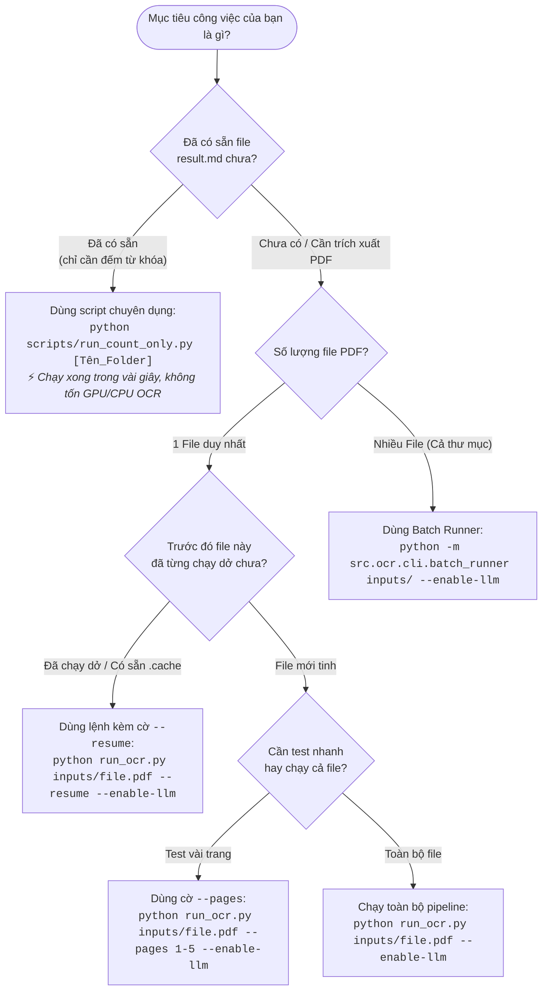

# CẨM NANG HƯỚNG DẪN CHẠY LỆNH & CÁC KỊCH BẢN THỰC CHIẾN
> **Dự án:** Hệ sinh thái OCR & Trích xuất Báo cáo Tài chính Đa tầng (PDF to Markdown & Keyword Counter)  
> **Phiên bản tài liệu:** 1.0  
> **Cập nhật:** 10/2026

Tài liệu này tổng hợp toàn bộ các công cụ dòng lệnh (CLI), kịch bản sử dụng thực tế và bảng tra cứu cờ (flags) để giúp bạn và đội ngũ lựa chọn câu lệnh tối ưu nhất theo từng nhu cầu, tránh lãng phí tài nguyên hoặc chờ đợi không cần thiết.

---

## MỤC LỤC
1. [Sơ đồ Lựa chọn Câu lệnh Nhanh (Decision Tree)](#1-sơ-đồ-lựa-chọn-câu-lệnh-nhanh)
2. [Các Kịch bản Thực chiến Thường gặp](#2-các-kịch-bản-thực-chiến-thường-gặp)
   - [Kịch bản 1: Đã có file result.md, chỉ muốn đếm lại từ khóa](#kịch-bản-1-đã-có-file-resultmd-chỉ-muốn-đếm-lại-từ-khóa)
   - [Kịch bản 2: Chạy OCR file PDF mới hoàn toàn (End-to-End)](#kịch-bản-2-chạy-ocr-file-pdf-mới-hoàn-toàn-end-to-end)
   - [Kịch bản 3: Tiếp tục xử lý file bị ngắt quãng hoặc muốn cập nhật (--resume)](#kịch-bản-3-tiếp-tục-xử-lý-file-bị-ngắt-quãng---resume)
   - [Kịch bản 4: Test nhanh một số trang cụ thể (--pages)](#kịch-bản-4-test-nhanh-một-số-trang-cụ-thể---pages)
   - [Kịch bản 5: Chọn cấu hình xử lý tối ưu theo chất lượng tài liệu (--profile)](#kịch-bản-5-chọn-cấu-hình-xử-lý-tối-ưu---profile)
   - [Kịch bản 6: Chạy hàng loạt nhiều tài liệu (Batch Runner)](#kịch-bản-6-chạy-hàng-loạt-nhiều-tài-liệu-batch-runner)
   - [Kịch bản 7: Đo hiệu năng và đánh giá độ chính xác (Benchmark & Ground Truth)](#kịch-bản-7-đo-hiệu-năng-và-đánh-giá-độ-chính-xác)
3. [Bảng Tra cứu Toàn bộ Tham số CLI (Cheat Sheet)](#3-bảng-tra-cứu-toàn-bộ-tham-số-cli)
4. [Các Lưu ý Kỹ thuật & Xử lý Sự cố (Troubleshooting)](#4-các-lưu-ý-kỹ-thuật--xử-lý-sự-cố)

---

## 1. SƠ ĐỒ LỰA CHỌN CÂU LỆNH NHANH



---

## 2. CÁC KỊCH BẢN THỰC CHIẾN THƯỜNG GẶP

### Kịch bản 1: Đã có file result.md, chỉ muốn đếm lại từ khóa
> **Khi nào dùng:** Khi file PDF đã hoàn tất OCR và sinh ra `output/<Tên_thư_mục>/result.md`. Bạn muốn cập nhật lại bảng đếm `count_keywords.md`, đổi ngưỡng tương đồng, hoặc thử danh sách từ khóa mới **mà không muốn mất 10 - 20 phút chạy lại OCR từng trang**.

#### 1. Đếm cho một tài liệu cụ thể:
```powershell
python scripts/run_count_only.py FPT_Baocaothuongnien_2022
```
hoặc truyền đường dẫn thư mục:
```powershell
python scripts/run_count_only.py output/MSN_Baocaothuongnien_2022
```

#### 2. Đếm với file từ khóa tùy chỉnh khác:
```powershell
python scripts/run_count_only.py FPT_Baocaothuongnien_2022 --keywords-file config/my_custom_keywords.txt
```

#### 3. Điều chỉnh ngưỡng nhạy Tầng 2 (Mặc định chuẩn: 86%):
- **Muốn khắt khe hơn (chỉ bắt lỗi cực nhẹ $\ge 90\%$):**
  ```powershell
  python scripts/run_count_only.py FPT_Baocaothuongnien_2022 --min-sim 0.90
  ```
- **Tắt Tầng 3 (LLM Recheck), chỉ đếm thuật toán thuần:**
  ```powershell
  python scripts/run_count_only.py FPT_Baocaothuongnien_2022 --disable-llm
  ```

---

### Kịch bản 2: Chạy OCR file PDF mới hoàn toàn (End-to-End)
> **Khi nào dùng:** Bạn nhận được một file PDF báo cáo thường niên mới trong thư mục `inputs/` và cần chuyển đổi sang Markdown kèm bảng tần suất từ khóa.

#### 1. Chạy tiêu chuẩn khuyến nghị (Bao gồm OCR + Đếm từ khóa Tam Tầng):
```powershell
python run_ocr.py inputs/FPT_Baocaothuongnien_2022.pdf --enable-llm
```

#### 2. Chỉ chạy OCR cơ bản (Chỉ đếm chính xác Tầng 1, không dò lỗi chính tả Tầng 2-3):
```powershell
python run_ocr.py inputs/FPT_Baocaothuongnien_2022.pdf
```

---

### Kịch bản 3: Tiếp tục xử lý file bị ngắt quãng (`--resume`)
> **Khi nào dùng:**
> - Máy tính bị mất điện hoặc bạn vô tình ấn `Ctrl + C` ngắt giữa chừng.
> - Quá trình OCR đã hoàn thành 100/100 trang nhưng bị gián đoạn ở khâu xuất file hoặc đếm từ khóa.
> - Muốn chạy lại khâu đếm từ khóa mà vẫn đi qua đúng pipeline chính `run_ocr.py`.

```powershell
python run_ocr.py inputs/FPT_Baocaothuongnien_2022.pdf --resume --enable-llm
```

> [!TIP]
> **Cơ chế `--resume` hoạt động như thế nào?**  
> Hệ thống sẽ kiểm tra thư mục `.cache/` tương ứng của tài liệu. Những trang nào đã được nhận diện và xử lý thành công sẽ được **nạp trực tiếp từ cache** mà không gọi lại mô hình AI (PaddleOCR/VietOCR). Nhờ đó thời gian hoàn thành giảm từ 15 phút xuống chỉ còn **vài giây**!

---

### Kịch bản 4: Test nhanh một số trang cụ thể (`--pages`)
> **Khi nào dùng:** Tài liệu có 200 - 300 trang, bạn vừa sửa prompt hoặc muốn kiểm tra xem bảng biểu, trang mục lục, hoặc vài trang cụ thể OCR ra sao mà không muốn chờ chạy cả cuốn.

#### 1. Chạy một khoảng trang liên tục (ví dụ từ trang 1 đến trang 5):
```powershell
python run_ocr.py inputs/FPT_Baocaothuongnien_2022.pdf --pages 1-5 --enable-llm
```

#### 2. Chạy các trang rời rạc:
```powershell
python run_ocr.py inputs/FPT_Baocaothuongnien_2022.pdf --pages 1,12,35,80 --enable-llm
```

#### 3. Kết hợp vừa chọn trang vừa nối tiếp:
```powershell
python run_ocr.py inputs/FPT_Baocaothuongnien_2022.pdf --pages 10-20 --resume --enable-llm
```

---

### Kịch bản 5: Chọn cấu hình xử lý tối ưu (`--profile`)
Hệ thống cung cấp 3 cấu hình (Profiles) phù hợp với chất lượng ảnh scan đầu vào:

| Profile | Đặc điểm | Tốc độ | Khuyên dùng cho |
| :--- | :--- | :---: | :--- |
| `fast` | Bỏ qua tiền xử lý phức tạp, ưu tiên Tesseract/PyMuPDF Text | Rất nhanh | PDF điện tử nguyên bản (Native PDF), chữ sắc nét |
| `balanced` *(Mặc định)* | Tự động cân bằng giữa tiền xử lý ảnh và nhận dạng mô hình sâu | Trung bình | Đa số các báo cáo thường niên, tài liệu scan chuẩn |
| `accuracy` | Tiền xử lý tương phản cao, khử nhiễu, VietOCR nhận diện chữ khó | Chậm | Bản chụp ảnh từ điện thoại, scan nghiêng mờ, nhiều trang màu |

#### Ví dụ câu lệnh:
```powershell
# Chạy tối đa tốc độ cho file PDF đẹp:
python run_ocr.py inputs/FPT_Baocaothuongnien_2022.pdf --profile fast --enable-llm

# Chạy tối đa độ chính xác cho bản scan xấu:
python run_ocr.py inputs/FPT_Baocaothuongnien_2022.pdf --profile accuracy --enable-llm
```

---

### Kịch bản 6: Chạy hàng loạt nhiều tài liệu (Batch Runner)
> **Khi nào dùng:** Bạn có một thư mục gồm 10, 20 hoặc 50 file PDF báo cáo tài chính của các công ty khác nhau (`FPT`, `MSN`, `TRA`, `VAF`,...).

#### 1. Chạy toàn bộ file trong thư mục `inputs/`:
```powershell
python -m src.ocr.cli.batch_runner inputs/ --enable-llm
```

#### 2. Chạy batch nhưng tự động bỏ qua các file/trang đã làm rồi (`--resume`):
```powershell
python -m src.ocr.cli.batch_runner inputs/ --resume --enable-llm
```

#### 3. Xuất báo cáo tổng hợp Excel sau khi chạy Batch:
```powershell
python scripts/export_batch_excel.py
```

---

### Kịch bản 7: Đo hiệu năng và đánh giá độ chính xác
> **Khi nào dùng:** Khi nhóm muốn báo cáo số liệu thực tế (thời gian xử lý từng khâu, tỷ lệ lỗi từ WER, CER, dấu tiếng Việt so với ground-truth).

#### 1. Đo lường thời gian xử lý chi tiết (Benchmark):
```powershell
python run_ocr.py inputs/FPT_Baocaothuongnien_2022.pdf --benchmark --resume --enable-llm
```

#### 2. So sánh độ chính xác với Ground Truth chuẩn:
```powershell
python run_ocr.py inputs/FPT_Baocaothuongnien_2022.pdf --accuracy-report --ground-truth benchmark/ground_truth
```

---

## 3. BẢNG TRA CỨU TOÀN BỘ THAM SỐ CLI

### A. Công cụ chính: `run_ocr.py`
Cú pháp: `python run_ocr.py <đường_dẫn_pdf> [TÙY_CHỌN]`

| Tham số | Giá trị | Mặc định | Ý nghĩa & Tác dụng |
| :--- | :--- | :---: | :--- |
| `<input>` | Đường dẫn file PDF | *(Bắt buộc)* | File PDF cần OCR (tự động tìm trong `./`, `inputs/`, `examples/`). |
| `--enable-llm` | Cờ kích hoạt | `False` | **Khuyên dùng:** Bật bộ đếm từ khóa Tam Tầng (bắt lỗi chính tả OCR & dấu). |
| `--resume` | Cờ kích hoạt | `False` | **Khuyên dùng:** Bỏ qua các trang đã có trong `.cache/`, tăng tốc tối đa. |
| `--pages` | Chuỗi trang (vd: `1-5` hoặc `1,3,7`) | `None` (Tất cả) | Chỉ định trang cần xử lý thay vì toàn bộ tài liệu. |
| `--profile` | `fast`, `balanced`, `accuracy` | `balanced` | Cấu hình ưu tiên tốc độ hay độ nét OCR. |
| `--output` | Đường dẫn thư mục | `output` | Thư mục lưu kết quả Markdown và ảnh trích xuất. |
| `--min-keyword-similarity` | Số thực (vd: `0.86`, `0.90`) | `0.86` | Ngưỡng tương đồng tối thiểu cho từ mờ Tầng 2 (86% - 99%). |
| `--keywords-file` | Đường dẫn file `.txt` | `config/keywords.txt` | File danh sách từ khóa tra cứu. |
| `--benchmark` | Cờ kích hoạt | `False` | Xuất bảng đo đạc thời gian từng phân đoạn xử lý. |
| `--accuracy-report` | Cờ kích hoạt | `False` | So sánh CER / WER với thư mục ground-truth. |
| `--debug` | Cờ kích hoạt | `False` | Hiển thị log chi tiết hỗ trợ gỡ lỗi. |

---

### B. Công cụ đếm nhanh: `scripts/run_count_only.py`
Cú pháp: `python scripts/run_count_only.py [Tên_thư_mục_hoặc_đường_dẫn] [TÙY_CHỌN]`

| Tham số | Giá trị | Mặc định | Ý nghĩa & Tác dụng |
| :--- | :--- | :---: | :--- |
| `[target]` | Tên thư mục hoặc path | `FPT_Baocaothuongnien_2022` | Thư mục chứa `result.md` trong `output/`. |
| `--disable-llm` | Cờ tắt | `False` | Tắt Tầng 3 (LLM), chỉ đếm bằng Tầng 1 và Heuristic Tầng 2. |
| `--min-sim` | Số thực (vd: `0.85`) | `0.80` | Ngưỡng tương đồng tối thiểu Tầng 2. |
| `--keywords-file` | Đường dẫn file `.txt` | `config/keywords.txt` | Tùy chỉnh danh sách từ khóa tra cứu. |

---

## 4. CÁC LƯU Ý KÝ THUẬT & XỬ LÝ SỰ CỐ

### 1. Tại sao chạy lệnh trên Windows đôi khi bị lỗi Unicode?
- **Nguyên nhân:** Windows CMD/PowerShell mặc định dùng bảng mã `cp1252` hoặc `cp936`, không hỗ trợ đầy đủ các ký tự tiếng Việt có dấu khi in log.
- **Giải pháp:** Tất cả các CLI script chính trong dự án (`run_ocr.py`, `scripts/run_count_only.py`) đã được cấu hình tự động reconfigure UTF-8. Nếu chạy công cụ khác, hãy gõ lệnh sau trước khi chạy:
  ```powershell
  [Console]::OutputEncoding = [System.Text.Encoding]::UTF8
  ```

### 2. Có cần phải điền API Key cho Gemini/OpenAI trong `.env` không?
- **Không bắt buộc:** Nếu bạn để trống API Key, Tầng 3 sẽ tự động chuyển sang cơ chế **Heuristic Rule-Based Verifier** (hoàn toàn miễn phí, chạy offline, bảo vệ dữ liệu nội bộ).
- **Nếu có API Key:** Bạn có thể điền vào `.env` (`GEMINI_API_KEY=...` hoặc `OPENAI_API_KEY=...`) để mô hình LLM trực tiếp thẩm định ngữ cảnh cho những từ mờ ở mức độ tự nhiên nhất.

### 3. File kết quả sau khi chạy nằm ở đâu?
Mỗi tài liệu sau khi hoàn tất sẽ nằm trong thư mục `output/<Mã_Tài_Liệu>/`:
- `result.md`: Toàn bộ nội dung văn bản trích xuất chất lượng cao.
- `count_keywords.md`: Báo cáo chi tiết tần suất từ khóa kèm các biến thể OCR phát hiện được.
- `manifest.json`: Báo cáo chỉ số kỹ thuật, cấu hình pipeline và metadata.
- `quality.json`: Đánh giá chất lượng trang và cảnh báo.
- `pages/`: Từng trang Markdown riêng lẻ.
- `images/`: Các ảnh, sơ đồ, biểu đồ được cắt tự động.
